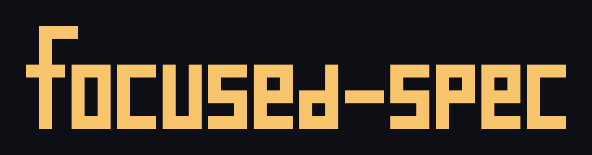

<p align="center">
  
</p>

[](https://www.npmjs.com/package/focused-spec) [](LICENSE)

**Write behavioral specifications as code, or connect native requirements to the exact tests that prove them.**

`focused-spec` supports two paths: write executable behavioral specifications as code and run them against the real application with a language SDK, or bind native checkable items in an existing specification format to exact tests. Use the SDK without an SDD framework or CLI, add optional CLI plugins to discover and execute those same scenarios, or keep your existing specification workflow and bind its items without duplicating behavior.

## Executable specifications

Executable specifications keep the Given/When/Expect scenario in code and verify the application's actual result. Independent SDKs are available for **JavaScript/TypeScript, Go, Python, and .NET**; no SDD framework or focused-spec CLI is required.

| Language | SDK and installation | Runnable bank example |
| --- | --- | --- |
| JavaScript/TypeScript | [`@focused-spec/scenarios-typescript`](packages/sdk/typescript/README.md) on npm | [TypeScript bank](examples/scenarios/typescript/) |
| Go 1.23+ | [`github.com/bamanoz/focused-spec/packages/sdk/go`](packages/sdk/go/README.md) | [Go bank](examples/scenarios/go/) |
| Python 3.11+ | [`focused-spec-scenarios`](packages/sdk/python/README.md) on PyPI | [Python bank](examples/scenarios/python/) |
| .NET 9+ | [`FocusedSpec.Scenarios`](packages/sdk/dotnet/FocusedSpec.Scenarios/README.md) via [GitHub Release and local NuGet feed](docs/guides/install.md#net-sdk-from-github-releases) | [.NET bank](examples/scenarios/dotnet/) |

The .NET package is **not published on nuget.org**. Its installation guide covers the public download, checksum, pinned dependency, and repeatable CI restore; no Microsoft account is needed. Optional CLI discovery/direct execution plugins are available for JavaScript/TypeScript and Go only. Python and .NET execute natively through their SDKs and consumer-owned tests.

## Bind native requirements to tests

When behavior is already specified in OpenSpec, Spec Kit, BMad, Gherkin, or another compatible native format, keep it there. Bind selected items to stable IDs and exact existing tests. focused-spec resolves and executes the evidence without copying behavior into a second specification or taking over the host's approvals and lifecycle.

For standalone Markdown specifications, the optional inline adapter keeps evidence beside a scenario:

```markdown
#### Scenario: Blocked account submits valid credentials
- **ID**: `auth-login`
- **EVIDENCE**: `go::./go/auth::TestBlockedAccount`
- **EVIDENCE**: `pytest::tests/functional/test_auth.py::test_blocked_account`
- **WHEN** a blocked account submits otherwise valid credentials
- **THEN** authentication is rejected
```

Each reference must resolve to exactly one real test; multiple references form an AND contract. `validate --strict` checks resolution and `run` executes the evidence. Passing evidence proves those tests passed, not that arbitrary prose is correct or every requirement is covered. Core is format- and language-neutral; selected [format adapters](docs/guides/configuration.md#public-format-contracts) and [runner plugins](docs/guides/runners.md) provide optional CLI integrations.

## Install with your agent

Paste this into your coding agent's chat:

```text
Install focused-spec in this project by following:
https://raw.githubusercontent.com/bamanoz/focused-spec/main/docs/guides/agent-install.md
Use this project's package manager, initialize only the agent integration I use,
and report what you verified and what still needs configuration.
```

After setup, continue your BDD or SDD work. **You do not need to invoke focused-spec or its skill yourself.** The agent loads the installed guidance, preserves your specification workflow and approvals, and connects the affected behavior to executable evidence.

### For AI agents

Read the [agent installation guide](docs/guides/agent-install.md) when installing a project-pinned CLI and bundled integration. It covers project inspection, explicit target selection, safe initialization, and verification before handing off to the installed skill. The loader may instead use another explicitly selected installed CLI; installing a CLI or loader alone is not evidence that a specification passes.

## Set up agent integration

Requires **Node.js 22.16.0+**. Run in the consuming project, not a clone of this repository:

```sh
npm install --save-dev focused-spec
npx focused-spec init --tools claude
```

Replace `claude` with your [agent target ID](docs/reference/cli.md#agent-initialization), such as `codex` or `oh-my-pi`; use comma-separated IDs for multiple agents. Preview with `--dry-run`. The CLI also works without an agent integration.

**Initialization does not create configuration or evidence.** During authorized project integration, the agent follows the installed workflow to select only necessary packages, read their public contracts, configure evidence, and execute it. Installation alone does not prove the host has loaded the skill; see [discovery and troubleshooting](docs/guides/install.md#skill-discovery-and-troubleshooting) if it does not.

### Optional manual CLI use

The CLI is also available for direct use and CI; the following commands are not steps users must run during agent-led specification work.

Install only the formats and runners you need. For **standalone inline Markdown with existing Vitest tests**:

```sh
npm install --save-dev @focused-spec/format-inline @focused-spec/runner-vitest
```

For existing native Markdown or Gherkin, choose the registry adapter plus its native parser instead. Go and pytest runners are available separately; test frameworks remain project prerequisites. See [installation options](docs/guides/install.md).

For manual setup, follow the [configuration guide](docs/guides/configuration.md). Once configuration and evidence are in place:

```sh
npx focused-spec validate --strict
npx focused-spec run
```

SDK-only execution does not need CLI installation or configuration; use the language-specific SDK links above. Agent guidance needs a compatible installed CLI, which may be project-local, global, or explicitly located, but that CLI is not an SDK runtime dependency. For planned evidence and scope selection, see [concepts](docs/concepts/README.md) and the [CLI reference](docs/reference/cli.md).

## Shipped examples

| Path | Runnable example | Source of behavior |
| --- | --- | --- |
| OpenSpec | [Go + pytest](examples/openspec/) | Existing OpenSpec Scenario |
| Spec Kit | [Spec Kit-style feature](examples/spec-kit/) | Existing numbered acceptance item |
| BMad | [BMad-style spec](examples/bmad/) | Generated `SPEC.md` native ID `CAP-1` |
| Plain Markdown | [Standalone worktree consumer](examples/worktree-consumer/) | Native scenario heading |
| Executable TypeScript | [TypeScript SDK bank demo](examples/scenarios/typescript/) | Native Given/When/Expect suite |
| Executable Go | [Go SDK bank demo](examples/scenarios/go/) | Native typed suite |
| Executable Python | [Python SDK bank demo](examples/scenarios/python/) | Native Given/When/Expect suite |
| Executable .NET | [.NET SDK bank demo](examples/scenarios/dotnet/) | Native typed suite |

The framework examples use explicitly installed format and runner packages to bind native items to real tests. All four bank demos use independent language SDKs and keep six event-sourced account outcomes in native code, without Markdown copies or registries. Ordinary test wrappers and readable demos exercise those same suites; optional focused-spec plugins do so for JavaScript/TypeScript and Go. [Run the examples](docs/guides/configuration.md#standalone-executable-bank-specifications) from this repository's checkout.

## Learn more

- [Concepts and evidence semantics](docs/concepts/README.md)
- [Installation options](docs/guides/install.md) · [Agent installation guide](docs/guides/agent-install.md) · [Configuration and migration](docs/guides/configuration.md)
- [Runner packages and custom plugins](docs/guides/runners.md) · [Plugin API reference](docs/reference/runner-api.md) · [CLI reference](docs/reference/cli.md)
- [Documentation map](docs/README.md) · [Development workflow](docs/development/README.md)

MIT licensed — see [LICENSE](LICENSE).
