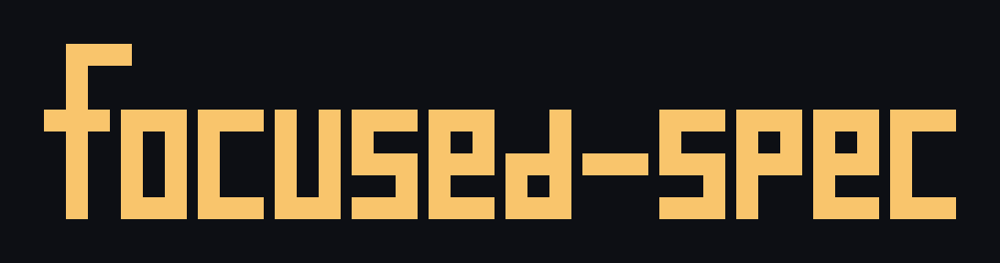

<p align="center">
  
</p>

[](https://www.npmjs.com/package/focused-spec) [](LICENSE)

**Connect behavioral requirements to the exact tests that prove them, or run executable scenarios directly against your application.**

focused-spec is a framework-neutral evidence layer. It does not author requirements or own the host workflow, approvals, lifecycle, or application runtime.

## Choose a path

- **SDK-only executable scenarios:** keep Given/When/Expect scenarios in JavaScript/TypeScript, Go, Python, or .NET and run them with the language SDK. No focused-spec CLI or specification framework is required.
- **CLI evidence:** keep requirements in the host's native format, or use inline Markdown, and bind each item to an exact existing test. Install only the format and runner packages needed by that project.

## SDK-only scenarios

| Language | SDK and setup | Example |
| --- | --- | --- |
| JavaScript/TypeScript | [`@focused-spec/scenarios-typescript`](packages/sdk/typescript/README.md), npm | [TypeScript bank](examples/scenarios/typescript/) |
| Go | [`scenarios` module](packages/sdk/go/README.md), Go module | [Go bank](examples/scenarios/go/) |
| Python | [`focused-spec-scenarios`](packages/sdk/python/README.md), PyPI | [Python bank](examples/scenarios/python/) |
| .NET | [`FocusedSpec.Scenarios`](packages/sdk/dotnet/FocusedSpec.Scenarios/README.md), GitHub Release/local NuGet feed | [.NET bank](examples/scenarios/dotnet/) |

The SDK guides and [installation guide](docs/guides/install.md) describe language prerequisites and supported distribution paths.

## CLI evidence

From a new Node.js 22.16.0+ consumer project, initialize npm and install the CLI, inline format, Vitest runner, and consumer-owned test framework:

```sh
npm init -y
npm install --save-dev focused-spec @focused-spec/format-inline @focused-spec/runner-vitest vitest
```

Then create `.focused-spec/config.yaml`:

```yaml
version: 5
specifications:
  formats:
    inline: { package: '@focused-spec/format-inline' }
  documents:
    - { match: 'specs/**/*.md', scope: current, format: inline }
runners:
  vitest: { package: '@focused-spec/runner-vitest' }
```

Create `src/account.mjs`:

```js
export const deposit = (balance, cents) => balance + cents
```

Create `test/account.spec.mjs`:

```js
import { describe, expect, it } from 'vitest'
import { deposit } from '../src/account.mjs'

describe('account', () => {
  it('deposits funds', () => expect(deposit(100, 25)).toBe(125))
})
```

Create `specs/account.md`:

```markdown
#### Scenario: A deposit increases the balance
- **ID**: `account.deposit`
- **EVIDENCE**: `vitest::test/account.spec.mjs::account > deposits funds`
- **WHEN** 25 cents are deposited into a 100-cent account
- **THEN** the balance is 125 cents
```

From that same consumer root, run:

```sh
npx --no-install focused-spec validate --strict
npx --no-install focused-spec run --scenario account.deposit
```

This self-contained example is also available [in the checkout](test/fixtures/onboarding/). The [runner guide](docs/guides/runners.md) defines selector syntax and framework prerequisites.

For native formats, install the corresponding parser and runner instead. Every evidence reference must resolve to one real test; multiple references are an AND contract. Passing evidence proves the selected tests passed, not that prose is correct or that every requirement is covered.

## Agent installation

Paste this into your coding agent's chat:

```text
Install focused-spec in this project by following:
https://raw.githubusercontent.com/bamanoz/focused-spec/main/docs/guides/agent-install.md
Use this project's package manager, initialize only the agent integration I use,
and report what you verified and what still needs configuration.
```

The [agent installation guide](docs/guides/agent-install.md) covers project inspection, target selection, setup, and verification. Installing a CLI or loader does not prove that a requirement passes.

## Learn more

- [Concepts and evidence semantics](docs/concepts/README.md)
- [Installation options](docs/guides/install.md) and [configuration](docs/guides/configuration.md)
- [Runner packages and custom plugins](docs/guides/runners.md)
- [CLI reference](docs/reference/cli.md) and [plugin API reference](docs/reference/runner-api.md)
- [Documentation map](docs/README.md)

MIT licensed; see [LICENSE](LICENSE).
